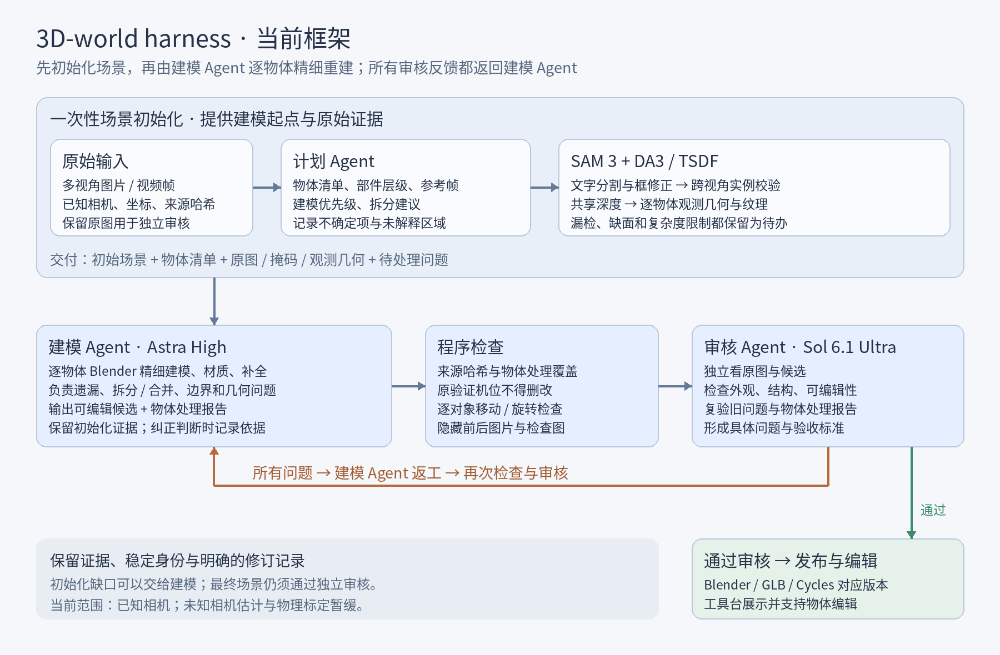
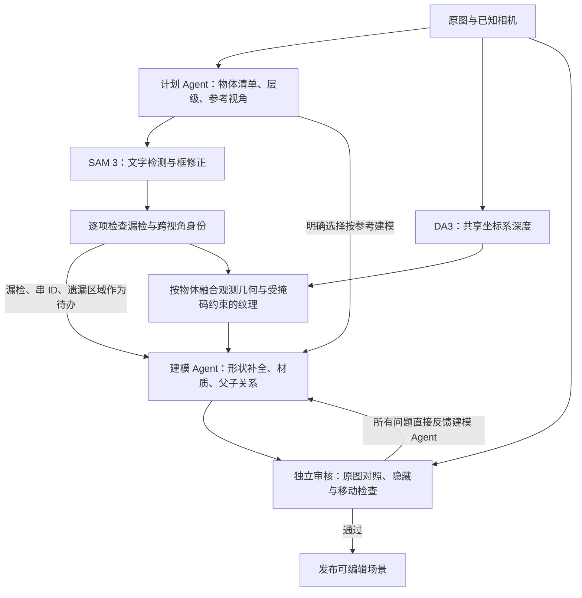

# 物体计划、SAM 3 分割与实例几何

这条流程先用已知相机、计划 Agent、SAM 3、DA3/TSDF 初始化场景，再由建模 Agent 逐物体精细重建。审核的所有问题直接反馈同一个建模 Agent；初始化清单、掩码和观测网格都是参考证据，可以在最终模型中依据原图纠正。物理与未知相机估计暂缓。`ready` 只表示初始观测资产可用，不代表场景审核通过。



## 在工具台回溯过程

场景上方常驻六个阶段入口：参考资料、场景初始化、精细建模、程序检查、审核反馈、验收交付。点阶段打开只读过程面板，左侧切阶段、右上角切该阶段保存的记录；每次只展示所选阶段的内容。物体编辑有独立入口，仅操作当前工作场景。

侧边栏「会话模型 → 操作审批」可选手动确认或自动确认，默认手动。自动模式在工具台页面打开时，通过现有审批接口允许当前会话的命令执行、文件修改，以及 scene_feedback 的预览、检查、构建和评估工具确认；发布、权限扩展、提问、真正需要填写的表单和无法完整显示的请求仍需手动处理。选择按浏览器、项目和会话保存，刷新后保留，关闭页面暂停自动处理。多个标签页通过浏览器锁协调同一请求，响应失败时切回手动并保留提交记录，不自动重试不确定的请求。此开关适用于 App Server 工具台，不修改审核 Agent 的只读权限。

- 初始化默认显示保留的 DA3/TSDF 粗场景，可切换物体计划、SAM 掩码和逐物体几何记录。计划与掩码绑定各自运行记录，不跟随最新一轮漂移。
- 建模可切换首次候选和反馈返修结果，查看对应固定视角渲染、独立三维模型及处理明细。历史三维查看不会切换主工作台场景或触发发布；预览照明不等同于 Cycles。
- 审核页显示实际模型配置、所审核候选的对象数、报告中的检查范围、各项结论及分类问题单。选择一个问题后查看证据、返工目标与对应原图区域；旧审核结论不会套用到新返修结果。
- 未完成或缺失的阶段显示明确空态。JSON 原始记录收在折叠区，历史记录损坏会提示；图像与模型按对应构建哈希验证，客户端不能通过任意文件路径取项目文件。

历史索引读取 `object_pipeline/*/round_*`、`reconstruction/*/round_*` 的已保存报告与构建记录，不伪造未保存的过程。新的多视角初始化同时保留 `initialization/scene.json`；可另用 `build_world(scene=该快照)` 生成只读预览，将构建记录写入 `initialization/build_receipt.json`。没有预览构建时只展示保存的记录。后补生成的预览表示对原初始化资产的可视化，不代表重新执行了初始化或通过了验收。

## 审核反馈分类

反馈直接交给建模 Agent，每条绑定稳定问题 ID、物体 ID、原图/比较视角、归一化区域、具体证据和可复验条件。同一物体的独立缺陷分别记录：

| 类别 | 典型证据 | 修复与复验方向 |
| --- | --- | --- |
| `spatial_structure` · 空间结构错误 | 任意物体/部件的凹凸或内外反转、前后/朝向/厚度错误、连接错位、穿插或悬空 | 优先核对相机与坐标，再以多视角视差、遮挡和可信深度检查；明确参照对象、部件或表面及局部方向，核对接触、包含和遮挡关系 |
| `silhouette` · 轮廓错误 | 尺寸比例、边缘或布料垂落形状不匹配 | 先核对相机，再修几何，在对应及其他可见视角检查轮廓 |
| `texture_alignment` · 纹理错位 | 图案位置偏移、拉伸、接缝或投影重影 | 修 UV、来源视角和遮挡投影，检查图案位置与跨视角一致性 |
| `lighting` · 光照偏差 | 光斑、阴影方向/软硬、照明颜色或曝光不匹配 | 修灯光与曝光，对照相同相机的 Cycles；不能往底色贴阴影补偿 |

其他问题继续使用 `inventory`、`segmentation`、`geometry`、`appearance`、`editability`；材质底色/粗糙度问题归 `appearance`。颜色差异不能直接证明灯光有错：原因不确定时用 `appearance` 描述已观察到的偏差、可能原因及下一步诊断。审核必须区分观察和推断，不能依据工作台导航照明给场景灯光定错。旧报告保持原类别，不自动猜测重分类；新增分类不代表已经接入几何优化、贴图或光照反演算法。

先审核所有物体的空间结构及相互关系，再细化局部轮廓、纹理和照明。例如枕头凹陷被建成鼓包、把手嵌进柜体、被褥上下层颠倒、桌腿连接到错误一侧，都属于此类；不局限于房间或墙面。亮暗只能作为辅助线索；DA3/TSDF也是估计证据，不能用同一深度模型的结果自证凹凸方向。争议区域至少对照两个有平移视差且能看清边界的原始视角（若输入具备），检查遮挡、侧面及表面前后关系；证据不足时记录不确定性和缺少的检查，不能强判。可请求不带照片纹理的中性材质、深度/法线或俯视剖面辅助展示候选几何，这些模型派生图不是真值，也不代表已自动生成。验收应描述相对参照对象/部件/表面的方向、位置、厚度或连接关系及跨视角一致性，曲面不强制使用平面基准，涉及多个物体时注明相关ID，避免仅要求“看起来更凸”；空间结构未解决不能靠修改贴图或灯光掩盖。

## 运行完整流程

入口为 `scripts/run_reconstruction.py`，前置输入沿用[已知相机多视角流程](multiview-reconstruction.md)的 prepared 原图、DA3 深度与已初始化世界。先复制并填写 [runtime.example.json](../examples/object_pipeline/runtime.example.json) 中本机的执行程序和权重路径。计划和审核分别运行只读 Codex 会话；建模复用工具台当前 Astra High 会话。运行环境可为角色指定 `home`，控制器只在调用该角色时设置 `CODEX_HOME`。

```bash
python scripts/run_reconstruction.py \
  --project /path/to/project --runtime /path/to/runtime.json \
  --url http://127.0.0.1:18779 --max-rounds 3
```

`--stop-after plan|segment|geometry` 可在对应初始化阶段结束后停下，不启动后续建模。默认 `review` 运行完整闭环。`--max-rounds` 限制本次调用的建模/审核轮数为 1–3。初始化只执行一次，漏检、几何不足、明确的复杂度限额和未解释区域保留为建模待办，交给建模 Agent 处理；程序执行失败、来源或哈希错误仍明确报错。

`--stop-after feedback-modeling --max-rounds 2` 运行一次建模和一次审核，再交给建模 Agent 处理反馈后停止，不进行第二次审核或自动发布。首次审核直接通过时也保留候选，交给建模 Agent 完成自检后等待用户查看。停止状态为 `modeled`，报告格式有问题则明确记录待修正。审核停止点持久保存，同模式续跑不会重复已完成的反馈建模；下次改用默认 `review` 可审核保留的最终候选。

已有 `modeled` 候选需要追加两轮时，使用 `--repair-from RUN_ID --repair-cycles 2`（其余 project/runtime/url 参数相同）。它新建运行记录，复用原初始化证据，按“审核现有候选 → 返修 → 审核返修候选 → 返修”执行。两轮仅计本次新增审核，每轮都将反馈交给建模 Agent；即使审核通过也不发布。最终返修尚未复核，停下供用户查看。`--resume NEW_RUN_ID` 保留原次数与已提交的建模任务，已结束批次不会再派单；审核调用中断且结果未确认时明确停止，不自动多开一次审核。需要再追加工作时显式使用新的 `--repair-from`。

建模 Agent 保持 Astra，推理强度使用工具台当前已验证的会话设置，运行及审核记录保存实际档位，不再固定 High。先在空闲工具台调整强度，再开启新批次；当前账号支持 Ultra 时可使用最高档。若上批返修已完成、仅其后的审核失败，也可显式从该候选新开批次，旧失败记录保持不变；未完成的建模不能作为此入口的起点。

运行配置的 `review_timeout` 控制每次审核的最长执行秒数；未配置时保持2400秒，完整多物体 Ultra 审核的示例配置为14400秒。超时仍明确停止、不自动多开审核，并保存原审核线程ID及简短错误，便于核对冻结证据后恢复。

```bash
python scripts/run_reconstruction.py \
  --project /path/to/project --runtime /path/to/runtime.json \
  --url http://127.0.0.1:18779 --resume RUN_ID --max-rounds 1
```

显式续跑使用原运行 ID，复用已完成的初始化阶段，只补尚未完成的步骤。后续审核返工不重调计划、SAM或TSDF，全部交给建模 Agent。若已提交的建模任务尚未审核，则等待同一反馈并审核已有候选，不重新发送建模任务；响应丢失时通过保存的请求键查找已提交反馈，查不到则明确停止。已发布世界发生变化时拒绝继续旧运行。已有证据在复用前重新检查来源和文件哈希。

运行状态位于 `object_pipeline/status.json` 与 `object_pipeline/<run_id>/status.json`，每轮保留计划、分割、几何、建模提示与候选。旧审核仍保存在 `reconstruction/`；状态同时记录关联审核运行和报告。工具台的“重建流程 / 物体编辑”显示当前计划及分割证据、待解决事项、独立审核和已发布对象，三者分别展示。

## 建模阶段预览

建模 Agent 每完成一组有意义的物体就构建当前候选，调用 `workspace_preview_world(receipt_path, expected_scene_revision, summary)`。中间构建可使用 `render=False`，工具台立即显示可选择的 GLB，并标注“建模预览 · 未验收”。控制器等待建模时也会自动展示最新完成的构建，重复检查同一构建不会增加显示版本。

用户可查看、选中、定位、标注并提交修改意见。已有标注继续绑定原截图版本，更新不会把标注挪到新几何上。预览对象来自该构建的场景快照，支持对应 Blender 文件的 Cycles 预览；直接位置/旋转编辑保持关闭，由建模 Agent 根据反馈修改候选。

预览只更新显示，不写 `world/scene.json`，也不改变审核结论。预览入口检查场景与构建绑定、GLB对象ID及构建文件哈希；正式的移动旋转、隐藏残留、物体覆盖和质量验收仍在独立审核阶段执行。构建或预览更新失败会明确记录，不能当作验收通过。

审核问题的 `category` 为 `inventory`、`segmentation`、`geometry`、`appearance` 或 `editability`，仅描述缺陷类型，全部直接反馈建模 Agent。它负责补漏、纠正实例和拆分、细化形状、材质与可编辑性，必要时自行调用局部建模/分割工具。新发现的清单外物体可用 `object_id=scene` 和 `source_<frame_index>` 原图区域报告。旧问题必须保持 ID 或明确解决。新冻结审核协议为 `workflow_version=2`；历史 `target` 报告仍可读取。只有独立审核及确定性检查通过，才接受并发布。普通手动发布接口仍是独立路径。

计划流程的候选必须完整保留当前世界的固定验证相机、内参和原图路径，可增加检查视角，不能删除或改绑原有视角。独立重开 Blender 后，逐对象进行变换检查，并生成隐藏自身及后代前后的图像与接触表。相机按投影包围盒选择，遮挡可能仍使检查不充分，审核 Agent 必须指出并要求补机位。`edit_visual_coverage` 只证明每个应检对象有检查图片，物体分离正确性由原图和逐对象图片共同审核。

runtime 中的工具命令是 JSON 参数数组，支持 `{repo}`、`{project}`、`{run_dir}`、`{run_relative}`、`{plan}`、`{segments}`、`{output}`；控制器不执行 shell 字符串。可用它配置隔离容器，项目输入只读，只有本次运行目录可写。Spark 的实际配置在 `/home/yao/3D-harness/runtime/object-pipeline.json`，复用已有 SAM 3 和 DA3/Open3D 镜像。接口不自动下载权重或切换分割/审核模型。



## 计划与文件约定

所有操作使用独立运行目录。下面以工程内的 `reconstruction/run_01/` 为例；路径全部相对于当前工程，不接受逃逸路径。原始图片、相机、DA3 深度和旧运行不被覆写。

`plan.json` 包含 `schema_version=1`、`summary`、`source_manifest_sha256`、`objects`、`unexplained_regions` 与 `excluded_objects`。`source_manifest_sha256` 绑定 `observations/manifest.json`。每个物体包括：

- `id`：稳定且唯一；更改名称不改变身份。
- `name`、`category`、`parent_id`、`kind`（`group`、`object`、`part`、`structure`）。
- `priority`、`geometry_strategy`（`fuse`、`model`、`group`）、`segmentation_prompt`。
- `observations`：原始 `frame_index`、归一化 `[x0,y0,x1,y1]` 框和证据描述。只使用冻结的训练图像；留出图像不得进入计划、分割或几何融合。
- `uncertainty`、`acceptance_criteria`：缺失证据和可执行验收条件。

计划不能凭 SAM 未检出就删除对象。初始化时明确排除的对象须进入 `excluded_objects` 并保留理由与证据帧；后续视角、框或物体层级的纠正由建模 Agent 处理，并记录在建模报告中。选择 `geometry_strategy=model` 表示 Agent 明确根据原图直接建模；它不会自动将分割失败伪装成成功融合。

## 精细建模与处理报告

建模 Agent 收到全部初始证据与待办，负责最终几何、材质、父子关系和每轮审核返工。初始清单不锁死最终拆分粒度；可以有依据地纠正误识别、拆分、合并或排除，并保留身份对应记录。

每个候选同目录必须提交 `modeling_report.json`，控制器会预先提供 `modeling_report_schema.json`：

- `schema_version=1`、`plan_sha256`、`summary` 绑定初始化计划。
- `objects` 覆盖每个初始非group物体，记录 `plan_id`、最终 `scene_ids`、`resolution`、`reason`、`frame_indices`。
- `regions` 覆盖每个初始未解释区域，使用 `region_index` 及同样的最终对象、处理结果和原图依据字段。
- `resolution` 为 `modeled`、`excluded` 或 `unresolved`。建模结果允许显式一对多/多对一映射；排除必须有原图依据。所有引用的最终对象必须真实存在于候选，证据必须包含对应初始物体/区域的训练帧。

报告漏项或仍有 `unresolved` 不通过程序覆盖检查。完整报告也不代表质量通过：审核必须对照原图检查每条映射、排除、补全和最终对象，防止文字说明掩盖缺失物体。报告、候选与全部证据一起冻结，原初始化文件保持不变。

报告缺失、JSON/schema 错误或对象映射格式不合法时，控制器保存独立的建模返工诊断，并在下一轮要求建模 Agent 修复；续跑不会反复等待已完成的坏候选。该诊断不冒充独立审核报告，也不覆盖历史审核。原图、初始化证据或哈希损坏仍直接报错。

## SAM 3 分割

在安装了官方 SAM 3 及其权重的环境中运行：

```bash
python scripts/sam3_segment.py \
  --project /path/to/project \
  --plan reconstruction/run_01/plan.json \
  --output reconstruction/run_01/segmentation \
  --checkpoint /path/to/sam3.pt
```

`--output` 必须是新目录。适配器先尝试文字提示，按计划框匹配实例；失败后用 SAM 3 的交互框提示修正。它不会自动切换 SAM 2。输出为：

- `segments.json`：绑定计划与原图清单哈希；记录模型版本、权重哈希、阈值以及每次尝试。
- 每对象 `status`：`segmented`、`missing`、`uncertain`、`not_required`。没有检出的对象仍留在清单里。
- 每有效观察：`frame_index`、`mask_path`、`mask_sha256`、`score`、`prompt_method`、`overlay_path`。掩码是与对应 prepared 原图同尺寸的 0/255 PNG。

当前适配器对选定图片独立推理，尚未使用 SAM 3 视频传播。`segmented` 只说明取得二维掩码；模型分数、框重合率均不代表正确身份的概率。相邻同类物体、遮挡部件和语义边界仍需几何与原图检查。

Spark 已有隔离运行方式（不需重新下载权重）：

```bash
docker run --rm --gpus all --network none --user "$(id -u):$(id -g)" \
  -v /home/admin/workspace/projects/sam3:/workspace/projects/sam3:ro \
  -v /home/admin/workspace/models/sam3:/workspace/models/sam3:ro \
  -v /home/yao/3D-harness/3D-world-harness:/repo:ro \
  -v /path/to/project:/project:ro \
  -v /path/to/project/reconstruction/run_01:/project/reconstruction/run_01 \
  --entrypoint python sam3d-objects:dgx-seg /repo/scripts/sam3_segment.py \
  --project /project --plan reconstruction/run_01/plan.json \
  --output reconstruction/run_01/segmentation \
  --checkpoint /workspace/models/sam3/sam3.pt
```

## 逐物体几何证据

在已有 DA3/Open3D 环境中运行，不需要再次载入 DA3 模型：

```bash
python scripts/reconstruct_objects.py \
  --project /path/to/project \
  --plan reconstruction/run_01/plan.json \
  --segments reconstruction/run_01/segmentation/segments.json \
  --output reconstruction/run_01/geometry
```

该步骤复用 `dense/depths.npz` 的深度、置信度、相机和处理后 RGB，并检查其 `inference.json` 哈希绑定。工程的 `split_manifest.json` 所指原数据目录仍需可读。Spark 的 `mv-sam3d:gb10-da3` 镜像已具备 Open3D；该步骤使用 CPU，无需 GPU。容器挂载需保留工程与原数据的绝对路径。

处理规则：

1. 通过原图内参与深度内参之间的变换映射掩码，兼容预处理缩放与裁剪。
2. 子部件拥有已标注的像素；祖先掩码扣除这些像素。无父子关系的重叠像素从双方剔除并报告冲突。
3. 边界收缩一个深度像素。每个保留深度点需获得其他视角同一 ID、相近深度的支持；可见冲突不能与支持打平。前景遮挡不算身份冲突。
4. 每个对象单独 TSDF 融合；未观测处保持开口，不自动补全。
5. 每个对象的贴图只包含其掩码内像素，其他位置为中性灰。面纹理来源还需通过深度与可见性检查；投影 UV 插值误差按既有方法限制。

输出 `geometry.json` 保留全部计划对象，状态为 `ready`、`insufficient_evidence`、`needs_revision` 或 `not_required`。有观测表面的对象生成独立 `observed.obj`、`observed.mtl`、`captured.png`；坐标与尺度保持原数据坐标。达到明确的 UV 面数或细分迭代上限时，该对象记为 `needs_revision` 并记录具体原因，其余对象继续；不自动降低质量，由建模 Agent 根据原图调整最终表示。其他执行错误仍中断并记录，不能冒充缺少观测。失败后显式续跑可复用已完成的计划和分割，仅重跑几何到新目录。

`objects[].files` 与顶层 `files` 是工程相对路径到 SHA-256 的映射，包含全部几何输出；`input_files` 绑定计划、分割、掩码、深度和校准文件。审核应验证这些哈希，不必复制大型深度文件。

## 限制与验证

2026-10-25 正式 Spark 工程的初始化证据包含78项计划，SAM 3 为77个非分组项生成二维掩码。逐物体报告为23项观测几何就绪、4项证据不足、1项 UV 面数超限、50项明确按参考建模或分组，另有8个未解释区域。这13项缺口作为建模待办保留，初始化已可交给建模 Agent，不能据此称场景还原完成。几何续跑复用原计划和掩码，未重复调用模型。运行记录为 `object_pipeline/20261025T051434Z-0ee3dce8/`。

新版审核另在独立合成工程实际调用 `gpt-6.1-sol / ultra`，读取冻结的建模报告、两张原图、候选渲染、逐物体隐藏检查与历史审核，110.48秒后返回 `revise`。它保留原两项问题 ID，并以 `geometry`、`appearance` 分类报告尺寸和背景偏差；新版 schema、报告绑定和冻结哈希校验通过，未发布。这证明真实角色接口和证据交接可用，不证明家具展厅已经还原。正式工具台的计划/证据检查与独立合成工程的旧发布、对象编辑、Cycles浏览器回归均通过。

跨视角检查可以发现部分串 ID、错边界和深度冲突，不能证明语义判断一定正确。只出现在一个视角的对象通常无法获得融合支持，但仍可以经计划明确选择按参考建模。缺失子部件的掩码不能自动确定其在祖先表面中的全部归属；审核还须进行隐藏、移动和残留纹理检查。照片纹理保留原光照、阴影和反光，尚未完成材质与光照分离。

2026-10-25 的真实联调复用了 Spark `multiview-bedroom-20261023-surface-preserved` 工程的原图第 1、7 帧：SAM 3 为台灯和椅子各得到两帧掩码；两者生成独立观测网格。故意构造的漏检提示仍以 `missing` / `insufficient_evidence` 留存。这是组件联调，不是完成或发布场景。

测试命令：

```bash
python -m unittest discover -s backend/tests -p test_sam3_segment.py -v
python -m unittest discover -s backend/tests -p test_reconstruct_objects.py -v
```

几何测试覆盖实际 TSDF、相机对齐、遮挡、错实例、父子所有权、邻居纹理隔离、漏检保留及输入哈希/留出图像检查。在缺少 Open3D 的环境中，两项融合测试显式跳过，不能把这种运行描述为融合验证通过。
